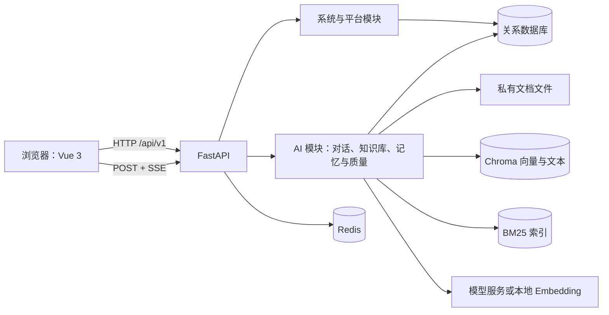

# FastCore 架构与开发指南

[文档目录](README.md) · [后端说明](../backend/README.md) · [管理端说明](../frontend/README.md) · [测试与验收](TESTING.md)

本文描述当前 `backend/` 与 `frontend/` 的运行链路。实际行为以源码、`backend/pyproject.toml`、`frontend/package.json` 和环境文件为准；历史设计稿与实现总结不作为运行说明。

## 系统概览

FastCore 是面向单组织企业应用的后端骨架，配套管理端并内置 AI 能力。前端负责登录、菜单导航、系统管理和 AI 工作界面；后端负责认证与权限、业务 API、数据初始化及 AI 知识库与对话。正常启动会连接关系数据库和 Redis；知识库还使用本地文件、Chroma 与 BM25 索引，AI 对话使用配置的模型服务。

| 边界 | 代码入口 | 职责 |
| --- | --- | --- |
| 前端启动 | `frontend/src/main.ts`、`src/plugins/index.ts` | 初始化 Pinia、路由、指令、国际化和组件库 |
| 前端鉴权与导航 | `src/store/modules/user.store.ts`、`src/router/` | 登录状态、授权菜单转换、动态路由注册和导航守卫 |
| 后端组装 | `backend/main.py`、`app/init_app.py` | 装配中间件、路由、生命周期和静态文件 |
| 通用后台 API | `app/api/v1/module_common/`、`module_platform/`、`module_system/` | 文件与健康检查、菜单、认证及系统管理 |
| 默认 AI 模块 | `app/plugin/module_ai/`、`module.py`、`plugin.toml` | 对话、知识库、记忆、模型配置、用量与质量；默认提供并可整套裁剪 |
| 业务模块组装 | `app/config/modules.py`、`app/core/modules.py` | 统一接入业务路由、模型、权限、种子、生命周期、索引和备份 |
| 数据初始化 | `app/scripts/initialize.py`、`app/scripts/migrate.py` | ORM 建表与种子数据、已有 Alembic 迁移 |

表中 `app/` 和 `src/` 分别相对于 `backend/`、`frontend/`。模块按功能组织；新增功能先沿现有调用链打通完整用例，再决定是否需要拆分更多文件。

## 启动、路由与权限

1. 从 `backend/` 运行 `uv run main.py run --env=dev`。CLI 先设置 `ENVIRONMENT`，再导入配置；`app/config/setting.py` 和 `app/plugin/module_ai/config.py` 读取对应 `backend/env/.env.dev`。
2. `create_app()` 注册异常处理、中间件、通用路由、AI 路由和静态资源。基础路由在 `app/init_app.py:register_routers()` 显式挂载；业务模块由 `app/config/modules.py` 登记，通过 `app/core/modules.py` 统一装配。AI 的 HTTP/WebSocket 路由、模型和启动钩子仍由 `app/plugin/module_ai/plugin.toml` 声明，`module.py` 接入统一组装。当前没有目录扫描式插件发现。
3. 应用生命周期先连接必需的 Redis。所有环境都在 Redis 锁下自动应用数据库迁移、创建缺失表并补齐稳定种子数据，结构校验失败即拒绝启动。随后执行已注册模块的启动钩子，初始化通用缓存及限流器；HTTP 与 WebSocket 使用 `RATE_LIMITER_TIMES` / `RATE_LIMITER_SECONDS`。启动初始化运行在可终止子进程中，锁续约失败会中止该进程。
4. 前端使用 Hash 路由。登录后用户信息中的菜单进入 `MenuProcessor`，由 `menuRoutes.ts` 转换，再经 `RouteRegistry` 校验并注册；`beforeEach.ts` 负责权限与导航。个人中心是静态隐藏路由，资料与密码操作仍由后端登录态校验。

前端 API 请求通过 `frontend/src/utils/http/` 发送。开发代理由 `frontend/vite.config.ts` 配置：`VITE_APP_BASE_API` 是浏览器使用的 API 前缀，`VITE_API_BASE_URL` 是代理目标；AI 对话也通过同一 HTTP 代理读取 SSE，旧 WebSocket 兼容入口仍保留。Vite 会加载 `.env` 和对应模式的 `.env.development`，后者可覆盖同名值。仓库模板与当前开发文件可能不同，联调前以实际加载值和后端监听地址核对。

## 数据库支持范围

FastCore 正式支持的运行和生产数据库为 **MySQL**。**SQLite 仅用于自动化测试和隔离验收**，不作为开发部署或生产数据库。

## 数据归属与知识库链路

| 数据 | 存放位置 | 开发时要确认的事 |
| --- | --- | --- |
| 用户、权限、菜单、知识库元数据、chunk 与状态 | MySQL（正式支持）；SQLite 仅用于测试与隔离验收 | 数据库目标、迁移与事务；自动化测试默认使用临时 SQLite |
| 启动锁、缓存、限流与会话相关状态 | Redis | 正常启动需要可访问的 Redis |
| 通用上传与知识库原件 | `backend/storage/upload/`、`backend/storage/knowledge/` | 私有文件与数据库记录的一致性；不要在 API 中暴露服务器绝对路径 |
| 向量与文本块 | `CHROMA_PERSIST_DIR` 指定的 Chroma 目录 | Embedding 模型变化时检查向量维度与集合 |
| 关键词索引 | `BM25_INDEX_DIR` 指定的本地目录 | 与文档重建、删除及检索模式保持一致 |
| 模型调用 | 本地 `fastembed`、配置的对话模型服务或远程 embedding 服务 | 对话模型可选 OpenAI Chat Completions、OpenAI Responses、Anthropic；embedding 单独配置 |

模型配置页可填写模型名，也可使用当前接口地址和 API Key 获取服务商模型列表后选择。获取列表不会保存配置；改用其他接口地址或在 OpenAI 与 Anthropic 之间切换时，保存前需填写对应接口的 API Key。

**真实纵向链路示例：上传知识库文档。**前端 `src/api/module_ai/knowledge.ts` 调用 `POST /ai/knowledge/document/upload`；后端 `knowledge/controller.py` 校验文档创建权限，再将文档写操作交给 `knowledge/document_lifecycle.py` 保存原件和持久化 `pending` 记录。进程内后台任务只是加速器；manifest 声明的恢复任务每 15 秒扫描可领取的文档，通过 SQL 条件更新领取，抽取文本、切块并按 `RETRIEVAL_MODE` 更新 Chroma、BM25 或两者，最后更新索引状态。上传成功只代表文件与记录已接收；应继续检查文档索引状态和检索结果。AI 对话在 `chat/` 中使用知识库检索结果，当前界面使用 `POST /ai/chat/stream`，通过 Bearer 令牌鉴权并返回 SSE；`chat/ws.py` 的 ticket 入口保留兼容。停止生成会取消本次 HTTP 请求并关闭模型流，只有提交完成后才发送 `done`，详见[对话流协议](AI_CHAT_STREAMING.md)。

- 索引租约默认 300 秒，每 30 秒续约；失败后等待 60 秒自动重试，最多 3 次。硬终止后过期的任务可被重启进程接管，耗尽次数会明确失败而不是永久 `indexing`；手动重建可重新开始。
- 每次索引生成使用独立分块标识，保存待清理列表；旧索引在新 SQL 分块提交后清理。删除先通过 SQL 阻止重新领取，外部索引和源文件清理由持久化删除状态恢复。检索须以未删除文档和当前 SQL 分块为准，不能仅信任外部索引命中。
- SQL、Chroma 与 BM25 没有跨系统原子事务。恢复机制不等同于分布式事务，也不自动证明所有历史孤立文件已修复；存储不可访问或连续失败仍需管理员排查。

**模块接口约定。**索引清理通过 Chroma 与 BM25 的 `delete_chunks(ids)` 删除指定代际，知识库处理逻辑不直接操作 collection 或索引 writer。Chat 通过 `MemoryService` 读取用户记忆并触发后台提取；身份转换、提取与保存、独立数据库事务由记忆模块负责，提取器位于 `memory/extractor.py`。这样存储实现或记忆规则变化时，调用方无需同步实现细节。

对应回归检查位于 `tests/plugin/module_ai/knowledge/test_chunk_deletion.py` 与 `tests/plugin/module_ai/chat/test_memory_workflow.py`：分别使用临时真实 Chroma/Whoosh 索引，以及临时 SQLite 加确定性模型替身，验证代际删除、其他文档保留、用户隔离和后台提交。这些检查不代表外部模型或生产验收。

文本模型使用 `ChatModel`；需要结构化工具调用的模型使用扩展协议 `ToolChatModel`。供应商内容块通过公共函数 `content_to_text()` 转换，调用方不依赖 LangChain 适配器的私有方法。知识文档的索引恢复、状态、租约、重试及跨存储清理由 `KnowledgeDocumentLifecycle` 集中处理；知识库与文档只读、检索仍由 `KnowledgeService` 提供。恢复 worker 负责启动、轮询和停止。

文档写操作的 controller 和恢复 worker 直接使用 `knowledge/document_lifecycle.py`，知识库删除委托它清理关联文档；`knowledge/_upload_recovery.py` 是上传核对的私有实现。生命周期 module 保留 HTTP 行为、权限和数据范围检查，自行负责事务结果与存储清理顺序，提交结果不确定时保留文件，孤儿回收在锁内确认无引用后才执行。这里采用 CodeVault Scheduler Reconciliation 的“SQL 保存事实、轮询核对”原则，沿用现有 SQL 原子认领及两个独立 worker，不引入全局 Leader 或进程内任务队列。

AI 内部依赖保持单向：`quality → chat / knowledge`、`chat → memory / knowledge`；`memory` 与 `knowledge` 不依赖其他 AI 功能。跨模块读取保存的回答使用 `chat.public.get_saved_answer()`，文档归属校验使用 `knowledge.public.validate_document_scope()`；质量评测继续使用承担检索与权限校验的 `KnowledgeService.query_retrieval()`，不直接访问知识库 CRUD。静态导入约束由 `backend/tests/test_module_boundaries.py` 检查，覆盖绝对、相对及函数内导入。AI 的 `module.py` 仍是组合根，统一登记各模块模型、索引和生命周期。

聊天提取任务属于聊天的事务发件箱：`chat.model.MemoryExtractionJobModel` 与一轮回答共用提交，`chat.memory_worker` 负责用户顺序、租约、重试、来源校验以及删除互斥；记忆写入和任务确认仍在同一事务内完成。`memory.public` 提供提取器与用户隔离的 `MemoryService`，模型只需实现 `complete(prompt)` 并由调用方显式传入，记忆模块不创建全局模型、不读取聊天表或计费上下文。原表 `ai_memory_extraction_job` 的名称、列、索引及状态语义保持原样，不需因 Python 路径变更迁移数据。自定义脚本需将 `memory.worker`、`memory.model.MemoryExtractionJobModel` 分别更新为 `chat.memory_worker`、`chat.model.MemoryExtractionJobModel`；调用记忆提取方法须传入 `chat_model`。

首页运营概览位于独立注册的 `app/api/v1/module_dashboard/`，负责组合账号与登录审计统计；`module_common/monitoring/` 只负责健康和就绪探针，不导入业务模型。概览 URL 仍为 `/common/monitoring/login-trend`，保留登录日志权限及数据范围过滤。核心认证、RBAC 与审计依赖属于后台基础能力，本次不为消除所有 import 而新增转发层。CodeVault 本次模块公开入口及双向依赖检索无匹配，沿用现有显式注册、SQL 发件箱和 Service 入口。

动态路由的移除回调和 iframe 缓存由 `RouteRegistry` 统一管理，菜单 store 只保存展示数据。退出登录同步清理路由，避免延迟清理影响再次登录；注册失败会回滚已添加的路由和 iframe 数据。此处采用 CodeVault `server-driven-route-registry` 的集中所有权原则；知识任务已有 SQL 租约和持久化状态，无需引入 `persistent-failure-guard` 的文件锁与 JSON 状态层。

新增回归检查覆盖模型内容转换、恢复资格、路由重复清理及缓存写入失败回滚。`frontend/tests/route-lifecycle-e2e.cjs` 使用隔离的 SQLite、模拟 Redis 与确定性模型，在真实浏览器中验证登录、刷新、菜单重建、退出和重新登录；不代表生产数据库或外部模型验收。

## 开发与验收入口

新增、修改和裁剪业务先读[模块增删改指南](MODULE_DEVELOPMENT.md)，新增业务从[标准模块模板：分类管理](STANDARD_MODULE_TEMPLATE.md)开始，沿用数据库约束、请求事务、功能权限、数据范围、菜单接入和端到端验收方式。范例接口和导航仅在开发环境启用；生产保留模型及迁移历史，正式业务使用独立命名并正常注册。

配置与运行命令分别维护在[后端说明](../backend/README.md)和[管理端说明](../frontend/README.md)。所有环境启动都会自动迁移与初始化目标库；`bootstrap` 和 `migrate` 仍可用于部署前显式执行。前端通过 Corepack 使用仓库声明的 pnpm；新 checkout 先通过 Vite 生成自动导入声明。

单测、组合检查、隔离浏览器、真实依赖与供应商的边界统一见[测试与验收](TESTING.md)。跨层验收需验证登录与权限、页面操作、API 响应、持久化及错误态。知识库上传要等待索引终态并检查实际召回，不能只看上传成功。

文档维护、调用额度与质量模块的操作限制分别见[文档管理](DOCUMENT_MANAGEMENT.md)、[用量与模型验证](AI_USAGE_AND_MODEL_CHECKS.md)、[回答反馈与评测](AI_QUALITY.md)。关系库、原件及索引的恢复流程见[备份与恢复](BACKUP_AND_RESTORE.md)。

## 修改功能的路径

- **系统 API**：从 `app/api/v1/module_*/<feature>/` 的 controller 进入，核对 service、数据访问、权限码与功能组 router；前端对应 `src/api/`、`src/views/` 和后端菜单。
- **AI 能力**：先核对 `module_ai/plugin.toml` 的声明和现有 `chat/`、`knowledge/`、`memory/` 边界。跨功能调用依赖拥有方的公开用例，避免直接耦合对方内部 CRUD、索引或 Provider Client。
- **前端页面**：核对用户菜单的 `route_path`、`route_name`、组件路径、`MenuProcessor`、`RouteRegistry` 与守卫；同时验证后端授权。
- **数据库模型**：Alembic `script_location` 是 `backend/app/alembic`，版本目录为 `backend/app/alembic/versions/`。生成迁移后审查脚本和数据影响；所有环境启动都会自动应用已提交迁移并校验结构。需要交付的版本文件应与代码一起纳入版本管理。

变更文档时，以代码入口、包脚本和环境模板为事实来源。入口总览放在根 `README.md`；子项目 README 只保留本子项目的操作说明；本文维护跨端调用链和验收边界。历史实现报告与设计稿保留其原始时间语境，不作为当前开发命令的依据。
